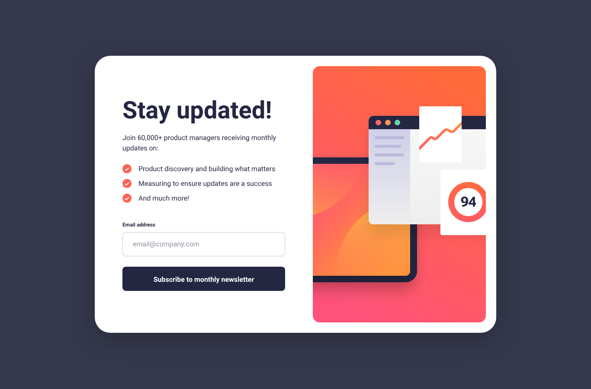

# Test Automation with Selenium WebDriver – Newsletter Sign-up Lab

Automated UI tests for my **Newsletter sign-up form with success message** from [QAM-lab1](https://github.com/123annick/QAM-lab1) ([live site](https://123annick.github.io/QAM-lab1/)), written in **Java 21 + Selenium WebDriver 4 + JUnit 5**, structured with the **Page Object Model / Page Factory**, and run automatically by **GitHub Actions** with **Slack** notifications.

| Grading metric | Where it is covered |
|---|---|
| Setup & configuration (15) | [Step 1](#step-1--set-up-the-project-maven) – `pom.xml`, `Config`, `DriverFactory` |
| Basic automated test with JUnit 5 (35) | [Step 3](#step-3--write-the-tests-with-junit-5) – `NewsletterSignupTest` (16 test runs) |
| Page Object Model (20) | [Step 4](#step-4--page-object-model--page-factory) – `pages/` package |
| GitHub Actions (30) | [Step 5](#step-5--ci-pipeline-with-github-actions) – `.github/workflows/ci.yml` |

---

## Project structure

```
selenium-newsletter-lab/
├── app/                                   ← the application under test, copied unchanged from QAM-lab1
│   ├── index.html, style.css, script.js
│   └── assets/
├── pom.xml                                ← Maven build: Selenium, JUnit 5, Surefire, logging
├── .github/workflows/ci.yml               ← GitHub Actions pipeline + Slack notification
└── src/test/
    ├── java/com/amalitech/newsletter/
    │   ├── config/Config.java             ← reads settings (baseUrl, headless, timeouts)
    │   ├── config/DriverFactory.java      ← creates & configures ChromeDriver
    │   ├── pages/BasePage.java            ← PageFactory init + explicit-wait helpers
    │   ├── pages/NewsletterSignupPage.java← Page Object: the form
    │   ├── pages/SuccessPage.java         ← Page Object: "Thanks for subscribing!"
    │   ├── tests/BaseTest.java            ← @BeforeEach / @AfterEach browser lifecycle
    │   ├── tests/NewsletterSignupTest.java← the JUnit 5 tests
    │   └── utils/ScreenshotOnFailureExtension.java ← screenshot when a test fails
    └── resources/
        ├── simplelogger.properties        ← log format for step-by-step logs
        └── junit-platform.properties      ← JUnit configuration
```

---

## Step 0 – Prerequisites

| Tool | Why | Check |
|---|---|---|
| JDK 21 or newer (e.g. 27) | compiles & runs the tests | `java -version` |
| Maven 3.9+ | downloads dependencies, runs tests | `mvn -v` |
| Google Chrome | the browser Selenium drives | open Chrome → *About* |
| Git + GitHub account | version control & CI | `git --version` |

**You do not need to download ChromeDriver manually.** Since Selenium 4.6, *Selenium Manager* (bundled inside `selenium-java`) detects your Chrome version and downloads the matching ChromeDriver automatically the first time `new ChromeDriver()` runs. (If your network blocks that, download ChromeDriver from the *Chrome for Testing* page and run with `-Dwebdriver.chrome.driver=/path/to/chromedriver`.)

---

## Step 1 – Set up the project (Maven)

**What I did:** created a Maven project and declared the dependencies in `pom.xml`.

```xml
<dependency>  <!-- Selenium: WebDriver API, ChromeDriver, PageFactory, waits, Selenium Manager -->
  <groupId>org.seleniumhq.selenium</groupId>
  <artifactId>selenium-java</artifactId>
  <version>${selenium.version}</version>
  <scope>test</scope>
</dependency>
<dependency>  <!-- JUnit 5 (Jupiter) annotations + assertions -->
  <groupId>org.junit.jupiter</groupId>
  <artifactId>junit-jupiter</artifactId>
  <scope>test</scope>
</dependency>
```

Explanation of the rest of the `pom.xml`:

- **`junit-bom`** (in `dependencyManagement`) pins every JUnit module to the same version, so `junit-jupiter` and `junit-jupiter-params` never clash.
- **`junit-jupiter-params`** enables `@ParameterizedTest` (one test, many inputs).
- **`slf4j-simple`** prints our step logs (`Typing email…`, `Clicking…`) with timestamps – these appear in the GitHub Actions log.
- **`maven-surefire-plugin`** is the plugin that actually runs tests during `mvn test`. I configured it to:
  - pass `headless`, `baseUrl`, `browser` as system properties (so you can do `mvn test -Dheadless=false`);
  - not trim stack traces and print output to the console (detailed CI logs);
  - use the **JUnit 5 tree reporter**, which prints every test with its `@DisplayName` as a ✔/✘ tree.
- **`<scope>test</scope>`**: these libraries are only needed for tests, not for a production build.

**Configuration classes:**

- `Config.java` – one place for settings. `baseUrl` defaults to the local `app/index.html`; `headless` is forced to `true` when the `CI` environment variable is set (GitHub sets `CI=true`).
- `DriverFactory.java` – builds `ChromeOptions` (`--headless=new`, fixed window size, `--no-sandbox` and `--disable-dev-shm-usage` which CI containers need) and returns `new ChromeDriver(options)`.

> From the Selenium docs (*Browser options*): options are how you configure a browser session before it starts – headless mode, window size, arguments.

---

## Step 2 – The application under test

The app is my **QAM-lab1** newsletter sign-up form (Frontend Mentor challenge), copied **unchanged** into `app/` so the tests and the CI pipeline always test the exact code in this repo. Before writing any test I read its `index.html` and `script.js` to list the behaviour to verify:

| # | Behaviour (from QAM-lab1) | Element / evidence |
|---|---|---|
| 1 | Form shows "Stay updated!", 3 benefits, email field, "Subscribe to monthly newsletter" | `#signup`, `#signup-title`, `ul.benefits li`, `#email` |
| 2 | Empty email → **"Email address is required"** | text injected into `#email-error` |
| 3 | Badly formatted email → **"Valid email required"** | same span; input gets class `is-invalid` and `aria-invalid="true"` |
| 4 | After a failed submit, focus goes back to the email field | `emailInput.focus()` |
| 5 | Real-time validation: no error while typing the first attempt; error on leaving the field (blur); live updates afterwards | `blur` / `input` listeners |
| 6 | Valid email → success card with the (trimmed) email, focus on the heading | `#success`, `#success-email`, `#success-title` |
| 7 | "Dismiss message" → empty form again, focus on the email field | `#dismiss-btn` |

| Form | Error state | Success state |
|---|---|---|
|  |  |  |

*Testability note:* most elements already had stable `id`s, which made locating them easy. The Subscribe button has no id, so it's located by its position in the form (`#signup-form button[type='submit']`). Adding `id="subscribe-btn"` would be a small improvement to the app.

---

## Step 3 – Write the tests with JUnit 5

`NewsletterSignupTest.java` – **10 test methods → 16 executions** (parameterized tests run once per input):

| Group (`@Nested`) | Test | What it proves |
|---|---|---|
| When the page loads | shows the sign-up form… `@Tag("smoke")` | title, heading, 3 benefits, placeholder, button text, no error |
| When a valid email is submitted | shows the success message… `@Tag("smoke")` | success card visible, form hidden, heading, exact email echoed, focus on heading |
| | trims spaces around the email | `"   ash@loremcompany.com   "` is shown trimmed |
| | 'Dismiss message' returns to an empty form | form back, field empty, no error, focus on field |
| When an invalid email is submitted | shows 'Valid email required'… ×6 | `ash#loremcompany.com`, `plainaddress`, `user@`, `user@domain`, `@nouser.com`, `user name@mail.com` → message, red style, `aria-invalid`, focus back, no success |
| | empty email shows 'Email address is required' ×2 | `""` and `"   "` |
| Real-time validation | no error while typing the first attempt | errors don't nag too early |
| | leaving the field shows the error | validation on blur (TAB key) |
| | error clears as soon as the email becomes valid | live feedback after first error |
| | message switches from 'required' to 'invalid' while typing | correct message for each state |

**JUnit 5 annotations used and why:**

| Annotation | Purpose |
|---|---|
| `@Test` | marks a test method |
| `@BeforeEach` (BaseTest) | start a **fresh Chrome** before every test → tests are independent |
| `@BeforeEach` (test class) | open the page before every test |
| `@AfterEach` | `driver.quit()` always – no leftover browsers |
| `@DisplayName` | readable names in reports and CI logs |
| `@Nested` | groups tests by scenario (given/when style) |
| `@ParameterizedTest` + `@ValueSource` | same test, many invalid emails – no copy-paste |
| `@Tag("smoke")` | run a quick subset: `mvn test -Dgroups=smoke` |
| `@ExtendWith` | plugs in the screenshot-on-failure extension |
| `assertAll(...)` | runs *all* assertions and reports every failure at once |

**Waits** (Selenium docs → *Waiting strategies*): I use **only explicit waits** (`WebDriverWait` + `ExpectedConditions`) – e.g. wait for the success card to become visible, wait until the input's `aria-invalid` attribute becomes `"true"` (or back to `"false"`). No `Thread.sleep()`, and no implicit wait, because the docs warn *"Do not mix implicit and explicit waits"* (it causes unpredictable timeouts).

**Screenshot on failure:** `ScreenshotOnFailureExtension` implements `AfterTestExecutionCallback`, which runs *before* `@AfterEach`, so the browser is still open; it saves `target/screenshots/<test>.png`. CI uploads these as an artifact.

---

## Step 4 – Page Object Model + Page Factory

**Idea:** tests describe *what* the user does; page classes know *how* to find and use elements. If the HTML changes, you fix one page class instead of every test.

```
BasePage  (PageFactory.initElements + click/type/textOf helpers with explicit waits)
 ├── NewsletterSignupPage   open(), enterEmail(), subscribeWith() → SuccessPage, submitInvalidEmail(), getErrorMessage()…
 └── SuccessPage            waitUntilLoaded(), getHeading(), getConfirmedEmail(), dismiss() → NewsletterSignupPage
```

**Page Factory:** fields are declared with `@FindBy`, and `PageFactory.initElements(driver, this)` in `BasePage`'s constructor turns them into lazy proxies – the element is looked up only when it is used, so it never goes stale between steps.

**Locator strategies demonstrated** (Selenium docs → *Locators*):

```java
@FindBy(id = "email")                                          // By.id – fastest, most stable
@FindBy(css = "ul.benefits li")                                // CSS selector, returns List<WebElement>
@FindBy(how = How.CSS, using = "#signup-form button[type='submit']")  // CSS for an element without an id
@FindBy(xpath = "//h1[@id='signup-title']")                    // XPath by attribute
@FindBy(xpath = "//button[normalize-space()='Dismiss message']")  // XPath by visible text
```

**Fluent navigation:** a method that moves to another page *returns that page object*:

```java
SuccessPage success = signupPage.subscribeWith("ash@loremcompany.com");
NewsletterSignupPage form = success.dismiss();
```

So a test reads like a user story, and tests contain **zero** `driver.findElement` calls.

**Element interactions** (Selenium docs → *Elements*): `click()`, `clear()`, `sendKeys()` (incl. `Keys.TAB` to trigger blur), `getText()`, `isDisplayed()`, `getDomAttribute("aria-invalid")`, `getDomProperty("value")`, and `driver.switchTo().activeElement()` to check keyboard focus.

---

## Step 5 – CI pipeline with GitHub Actions

File: `.github/workflows/ci.yml`

| Requirement | How it's met |
|---|---|
| Triggered on push / PR | `on: push`, `pull_request` (+ `workflow_dispatch` = manual button) |
| Install dependencies automatically | `actions/setup-java` (JDK 21 + Maven cache) → `browser-actions/setup-chrome` → `mvn test-compile` |
| Run the tests | `mvn -B -ntp -e test -Dheadless=true` |
| Detailed logs | tool versions printed; tree reporter shows each test ✔/✘; step logs with timestamps; full stack traces; `mikepenz/action-junit-report` writes a per-test table to the **job summary** and a **check** on the commit/PR |
| Artifacts | Surefire XML/TXT reports always uploaded; failure screenshots uploaded when something fails |
| Notifications | separate `notify` job (`needs: test`, `if: always()`) posts ✅ PASSED / ❌ FAILED to Slack with branch, commit, author and a link to the run |

**Manual run against the live site:** Actions → *Selenium UI Tests* → *Run workflow* → enter `https://123annick.github.io/QAM-lab1/` as `base_url`.

Other good practices: `concurrency` cancels an outdated run when you push again; `timeout-minutes` stops a hung browser from burning CI minutes; minimal `permissions`.

### Set up Slack notifications

1. In Slack: **Apps → Incoming Webhooks** (or create an app at api.slack.com/apps → *Incoming Webhooks* → *Add New Webhook to Workspace*) → pick the channel → copy the webhook URL.
2. In GitHub: **Repo → Settings → Secrets and variables → Actions → New repository secret**
   Name: `SLACK_WEBHOOK_URL`  Value: the URL.
3. Push a commit – the channel receives the build status. Without the secret the job just logs a notice and skips (the pipeline still passes).

---

## Step 6 – Run it

**Locally**

```bash
mvn test                       # headless Chrome, all tests
mvn test -Dheadless=false      # watch the browser
mvn test -Dgroups=smoke        # only @Tag("smoke") tests
mvn test -Dtest=NewsletterSignupTest   # one class
mvn test -DbaseUrl=https://123annick.github.io/QAM-lab1/   # test the live GitHub Pages site
```

Reports: `target/surefire-reports/`. Screenshots of failures: `target/screenshots/`.

**On GitHub**

```bash
git init && git add . && git commit -m "Selenium WebDriver lab"
git branch -M main
git remote add origin https://github.com/<your-user>/selenium-newsletter-lab.git
git push -u origin main
```

Open the **Actions** tab → *Selenium UI Tests* → see the logs, the test summary and download the artifacts.

Expected output (abridged):

```
[INFO] Running Newsletter sign-up form
[INFO] ├─ When the page loads
[INFO] │  └─ ✔ shows the sign-up form with heading, benefits, email field and button
[INFO] ├─ When a valid email is submitted
[INFO] │  ├─ ✔ shows the success message containing the submitted email
[INFO] │  └─ ✔ 'Dismiss message' returns to an empty sign-up form
[INFO] ├─ When an invalid email is submitted
[INFO] │  ├─ ✔ rejects "ash#loremcompany.com"
[INFO] │  ├─ ...
[INFO] └─ Real-time validation
[INFO]    ├─ ✔ leaving the field with an invalid email shows the error without submitting
[INFO]    └─ ...
[INFO] Tests run: 16, Failures: 0, Errors: 0, Skipped: 0
```

**Try a failing build** (to see the red Slack message & screenshot artifact): change `"Thanks for subscribing!"` in the test to something else, push, then revert.

---

## Resources used

- Selenium docs: [WebDriver](https://www.selenium.dev/documentation/webdriver/), [Browser](https://www.selenium.dev/documentation/webdriver/browser/), [Elements](https://www.selenium.dev/documentation/webdriver/elements/), [Locators](https://www.selenium.dev/documentation/webdriver/elements/locators/), [Waits](https://www.selenium.dev/documentation/webdriver/waits/)
- Test Automation University: [Selenium WebDriver with Java](https://testautomationu.applitools.com/selenium-webdriver-tutorial-java/), [Setting a Foundation for Successful Test Automation](https://testautomationu.applitools.com/setting-a-foundation-for-successful-test-automation/), [GitHub Actions for Testing](https://testautomationu.applitools.com/github-actions-for-testing/)

- My previous lab: [QAM-lab1 – Newsletter sign-up form](https://github.com/123annick/QAM-lab1)
